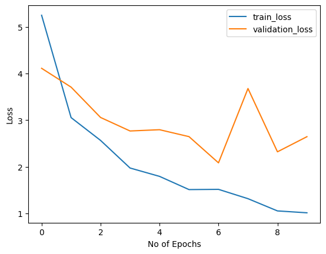

# 🌿 Plant Leaf Disease Recognition

A deep learning project that detects plant diseases from leaf images using a **Convolutional Neural Network (CNN) built from scratch in PyTorch**. The trained model can classify a single image or run **real-time predictions from a webcam** with OpenCV.

Early detection of plant diseases helps farmers act before a disease spreads and damages the harvest. This project explores how computer vision can support that process by recognizing the plant species and its health condition from a single photo of a leaf.

---

## 📌 Features

- Custom CNN architecture (8 convolutional layers + 2 fully connected layers)
- Train / validation / test split with reproducible data pipeline using `ImageFolder` and `SubsetRandomSampler`
- Training & validation loss tracking per epoch
- Accuracy evaluation on train, validation and test sets
- Single image prediction with human-readable disease names
- Disease information file (`disease_info.csv`) with descriptions and possible treatment steps
- **Real-time disease prediction via webcam** (OpenCV)

---

## 🗂️ Project Structure

```
plant-leafe-disease-recognition/
├── Bitki-Hastalik.ipynb      # Main notebook: data loading, model, training, evaluation, inference
├── disease_info.csv          # Disease names, descriptions, possible treatment steps, image URLs
├── assets/
│   └── loss_curve.png        # Training vs. validation loss plot
└── README.md
```

> The dataset folder (`plant_leave_disease_dataset/`) and the trained model weights (`plant_disease_model_1.pt`) are not included in the repository because of their size.

---

## 📊 Dataset

- **Total images:** 4,456 RGB leaf images
- **Number of classes:** 31 (different plant species and diseases, including healthy leaves)
- **Plants covered:** Apple, Blueberry, Cherry, Corn, Grape, Orange, Peach, Pepper, Potato, Raspberry, Soybean, Squash, Strawberry, Tomato

The dataset is organized in the standard `ImageFolder` format, one folder per class:

```
plant_leave_disease_dataset/
├── <class_name_1>/
│   ├── image (1).JPG
│   └── ...
├── ...
├── Strawberry__Leaf_scorch/
└── <class_name_31>/
```

### Data split

| Set        | Images | Ratio |
|------------|-------:|------:|
| Train      | 2,650  | ~60%  |
| Validation | 1,137  | ~25%  |
| Test       |   669  | ~15%  |

### Preprocessing

```python
transforms.Compose([
    transforms.Resize(255),
    transforms.CenterCrop(224),
    transforms.ToTensor(),
])
```

---

## 🧠 Model Architecture

The model is a custom CNN made of **4 convolutional blocks** followed by a fully connected classifier.

Each convolutional block:

```
Conv2d → ReLU → BatchNorm → Conv2d → ReLU → BatchNorm → MaxPool(2)
```

| Block   | Filters | Output size   |
|---------|--------:|---------------|
| Input   | –       | 3 × 224 × 224 |
| Conv 1  | 32      | 32 × 112 × 112 |
| Conv 2  | 64      | 64 × 56 × 56  |
| Conv 3  | 128     | 128 × 28 × 28 |
| Conv 4  | 256     | 256 × 14 × 14 |

Classifier:

```
Flatten (50,176) → Dropout(0.4) → Linear(1024) → ReLU → Dropout(0.4) → Linear(31)
```

- **Total parameters:** ~52.6M
- **Loss function:** CrossEntropyLoss
- **Optimizer:** Adam
- **Batch size:** 64
- **Epochs:** 10 (trained on CPU, ~7–8 minutes per epoch)

---

## 📈 Results

| Set        | Accuracy |
|------------|---------:|
| Train      | **86.9%** |
| Validation | **72.2%** |
| Test       | **71.0%** |



Training loss decreased steadily from **5.25 → 1.02** over 10 epochs, while validation loss dropped from **4.11** to around **2.1–2.6** with some fluctuation. The gap between training and test accuracy shows that the model is **overfitting**, which is expected for a model trained from scratch on a relatively small dataset. See [Future Improvements](#-future-improvements) for planned solutions.

---

## 🚀 Getting Started

### 1. Clone the repository

```bash
git clone https://github.com/yildizaydnn/plant-leafe-disease-recognition.git
cd plant-leafe-disease-recognition
```

### 2. Install dependencies

```bash
pip install torch torchvision numpy pandas matplotlib pillow opencv-python torchsummary jupyter jupyter-black
```

### 3. Prepare the dataset

Place the dataset in the project root in `ImageFolder` format, under a folder named `plant_leave_disease_dataset/`.

### 4. Run the notebook

```bash
jupyter notebook Bitki-Hastalik.ipynb
```

### Using the pre-trained model

Instead of training from scratch, you can download the trained weights:

👉 [plant_disease_model_1.pt (Google Drive)](https://drive.google.com/file/d/1WM1SZAh1H4-lF4raVMTnZb8kMshFulYc/view?usp=sharing)

Put the file in the project root and load it:

```python
model = CNN(31)
model.load_state_dict(torch.load("plant_disease_model_1.pt", map_location="cpu"))
model.eval()
```

---

## 🔍 Usage

### Single image prediction

```python
single_prediction("plant_leave_disease_dataset/Strawberry__Leaf_scorch/image (733).JPG")
# Output: Strawberry : Leaf Scorch
```

### Real-time prediction with webcam

Run the last cell of the notebook. A camera window opens and shows the predicted class on each frame. Press **`q`** to quit.

---

## 🛠️ Tech Stack

- **Python**
- **PyTorch & Torchvision**: model, training, data loading
- **NumPy & Pandas**: data handling
- **Matplotlib**: visualization
- **Pillow**: image processing
- **OpenCV**: real-time webcam inference
- **Jupyter Notebook**

---

## 🔮 Future Improvements

- **Transfer learning** with pre-trained models (e.g. ResNet, VGG16, EfficientNet) to improve accuracy and reduce overfitting
- **Data augmentation** (random flips, rotations, color jitter) to make the model generalize better
- **Image normalization** using ImageNet mean/std
- Using `model.eval()` and `torch.no_grad()` during validation, plus **early stopping** and saving the best checkpoint
- **GPU training** to train longer and experiment faster
- Detailed evaluation with a **confusion matrix** and per-class precision / recall / F1-score
- Matching the class indices of the model with `disease_info.csv`, so predictions show the right description and treatment steps
- Deploying the model as a **web or mobile app** (e.g. Flask / FastAPI / Streamlit)

---

## 👩‍💻 Author

**Yıldız Aydın**
GitHub: [@yildizaydnn](https://github.com/yildizaydnn)
